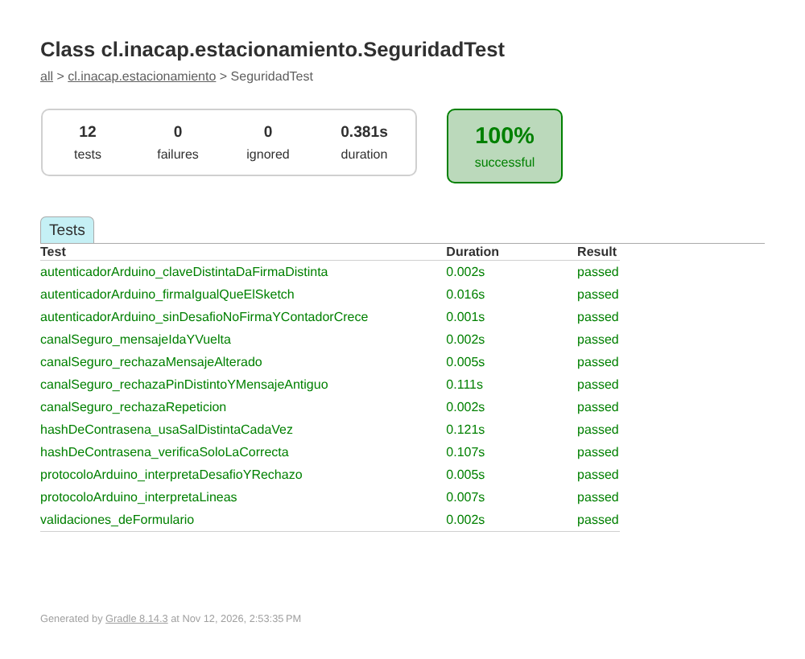

# Evidencia de pruebas

## Pruebas unitarias (`app/src/test/.../SeguridadTest.kt`)

Ejecutadas el 12-11-2026 con JUnit 4: **12 pruebas, 0 fallas, 0,38 s**.

| Prueba | Qué verifica |
|---|---|
| `hashDeContrasena_verificaSoloLaCorrecta` | PBKDF2 acepta la contraseña correcta y rechaza otra |
| `hashDeContrasena_usaSalDistintaCadaVez` | Misma contraseña → sal y hash distintos |
| `validaciones_deFormulario` | Reglas de usuario, contraseña y patente |
| `canalSeguro_mensajeIdaYVuelta` | Mensaje cifrado con el PIN se descifra en el otro teléfono |
| `canalSeguro_rechazaRepeticion` | Reenviar la misma trama → `NONCE_REPETIDO` |
| `canalSeguro_rechazaPinDistintoYMensajeAntiguo` | PIN distinto → `FIRMA_INVALIDA`; mensaje de 60 s → `TOKEN_EXPIRADO` |
| `canalSeguro_rechazaMensajeAlterado` | Un carácter cambiado → `FIRMA_INVALIDA` |
| `protocoloArduino_interpretaLineas` | Lectura de `P,1,1` y `B,E,0` |
| `protocoloArduino_interpretaDesafioYRechazo` | Lectura de `N,<hex>` y `E,AUTH` |
| `autenticadorArduino_firmaIgualQueElSketch` | La firma de la app coincide con la del sketch |
| `autenticadorArduino_sinDesafioNoFirmaYContadorCrece` | Sin desafío no se envía nada; el contador sube |
| `autenticadorArduino_claveDistintaDaFirmaDistinta` | Otra clave u otro desafío cambian la firma |

**Cómo se ejecutaron:** las pruebas se corrieron con apoyo de un asistente de IA (Claude) en un entorno JVM
(Gradle + JUnit 4, las mismas clases del proyecto), porque no se contaba con un dispositivo Android.
Para repetirlas: en Android Studio, clic derecho en `SeguridadTest` → *Run*, o `gradlew test`.

## Pruebas en dispositivos

La conexión entre dos teléfonos (Wi-Fi y Bluetooth) se demuestra en clase con dos equipos Android.
La integración con el Arduino corresponde a la próxima evaluación.
